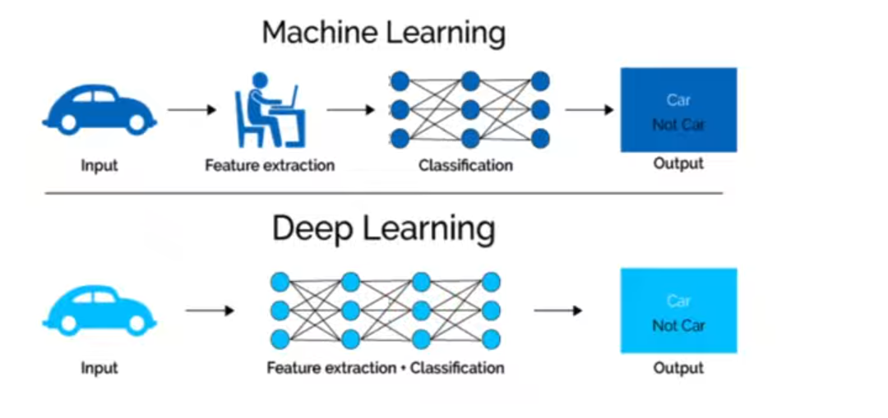
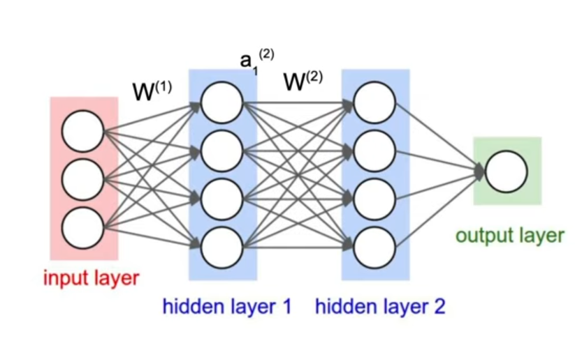
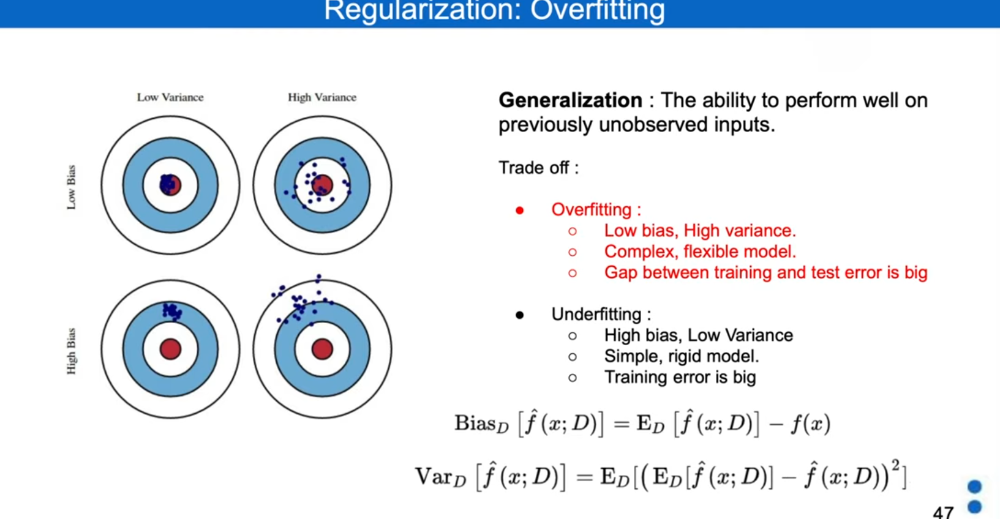
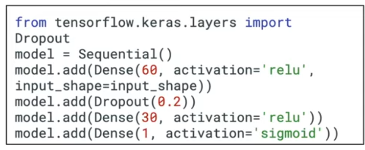

# INtroduccion

## Terminos

### Inteligencia artificial

Automatizar tareas normales que estban realizandose por humanos. SImplemente especificando reglas

### Machine learning

Algoritmos que mejoran autmaticamente a través de la experiencia. Entrenados mas que especificamente programados.

### DEep learning

REdes neuronales artificiales

En el deep learning se encuentran ejemplos prácticos como: NLP, computer vision, medicine, playing games, robotics,...

El deep learning es un funcionamiento práctico. MUchas veces no se entiende porq ha funcionado pero funciona.

Hasta ahora no se ha usado tanto este tema de deep learning, debido a la falta de datos. Ahora como tenemos una gran cantidades de datos, viene perfectamente poder usar la IA.

2 tipos de modelos de datos:

- HEliocentrismo: EStos modelos mas sencillos

- GEocentrismo: salian modelos muchos mas complejos

Otro tema importante por el que se usa ahora y no antes: el hardware

Estos modelos se dice que está inspirado en las redes neuronales humanas

#### PErceptron

UNidad minima de toda red neuronal. 
EStostienen unas entradas q son las entradas del modelo, unos pesos asociados a cada entrada (que se suman) y una funcion de activacion que puede ser lineal o no lineal.

Tambien es posible tener disitntas salidas. Cada neurona (que sera como un perceptron) tenemos una salida disitnta. Ya que esto puede ser que para cada neurona tenga disitntos pesos de los datos de entrada (multisalida).

Luego podemos ponerle otra capa más para que leugo de estos dos perceptrones tengan otro perceptron mas adelante (con estos dos de entrada) para asi tener una unica salida:

#### overfitting y underfitting

SE usa la regularizacion para corregir el problema con el overfitting y con el underfitting

algunos ejemplos son :
L2 y L1:    l2: DEjamos los mismos pesos y es el mas simple. L1:  es mas lento ya que se tiene que hacer una feature selection

Noise injection: Añade ruido random en el entrenamiento. Puede ser visto como una distorsion del dato para poder ayudar al mdelo a no ser overfit.

Dropout: SE asignan durante el entrenamiento algunas activaciones a 0 con una probabilidad p. no en la prediccion

