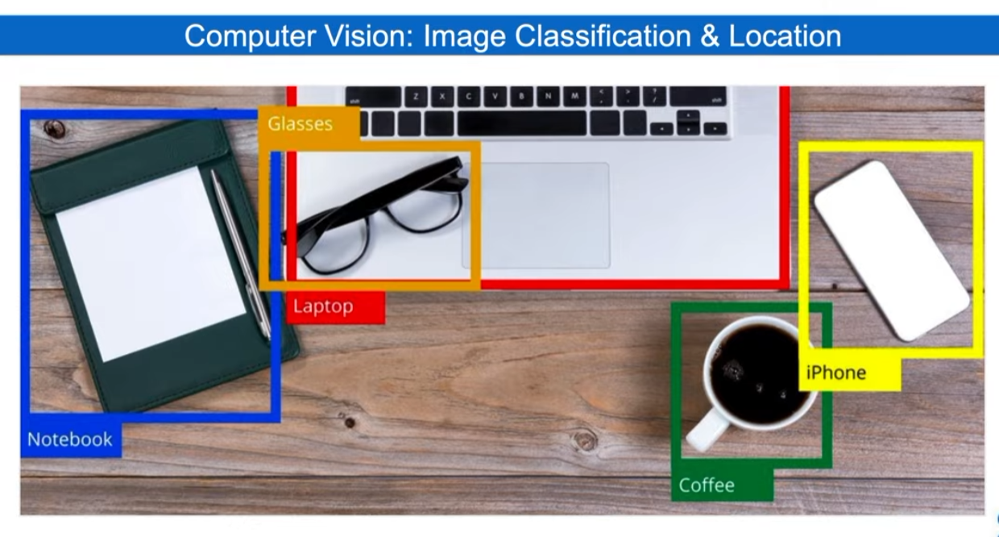
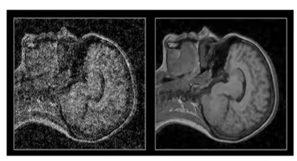
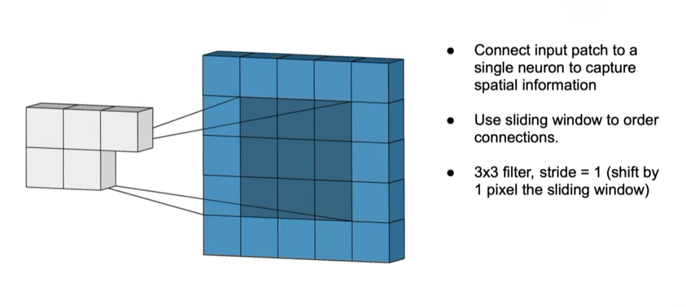
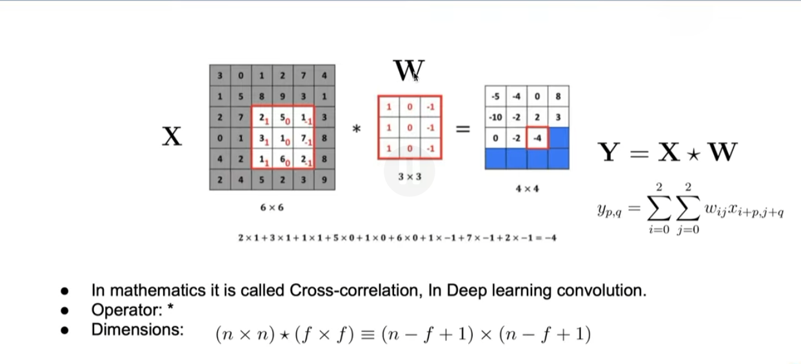

# CNN

Es un tipo de arquitectura que es la primera que empezo a destacar en el deep learning. Vamos a enfocarla principalmente al procesamiento de imagenes
Hay muchos datos a nivel imagen: muchos videos de youtube, fotos instagram, muchas camaras,...

La definicion de vision artifical es crear sistemas artificailes qsistemas que puedan procesar, percibir y razonar a aprtir de datos visuales
Ejemplo:

Una cosa mas complicada que simplement clasificar y detectar que es, y otra es ver que estan haciendo. Ya que no solo tiene que detectar lña imagen si no tmv la posicion, la cercania,... como por ejemplo  gente tocando al guitarra. 

Luego tmpc es solo identificar los objetos si no tambien saber que lleva (ejemplo, vaso con limon).
Luego tmb una aplicacion es poder reconstruir la imagen con una base. O tmb ppoder eliminar el ruido de las imagenes :

## FDuncionamiento

Las imagenes las tratamos como 1 y 0. Una imagen es una matriz de nuemtros enteros, entre 0 y 255. 0 es el negro y 255 el blanco. Entre emdias una escala de grises.

Cuando tenemos que incluir color, consta de 3 matrices. Rojo, verde y azul.

Con capas oculatas no se podría realizar ya que son muchiismos datos y es imposible. Son demasiados paremtros y tendria overfitting.

Para reducir un tamaño de una imagen, es ir reduciendo la matrizmultiplicandola por una matriz igual siemrpe:

En colores lo mismo, para cada una de las matrices de cada uno de los colores.
La imagen se va reduciendo de tamaño con este metodo. Para evitarlo, una manera que tenemos de evitarlo es el pading, que es añadir filas de 0 arriba abajo a la derecha y a la izquierda para evitar reducir el tamaño de la imagen

Ademas es importante tmb tener que entrenar el modelo con imagenes (por ejemplo apra clasificar un animal) desde distintas perspectivas, rotaciones, brillos,... para que asi el modelo pueda aprenderlas ya que no siempre va a estar una animal desde la misma posicion.