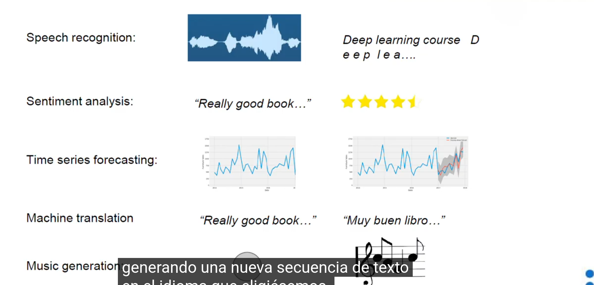
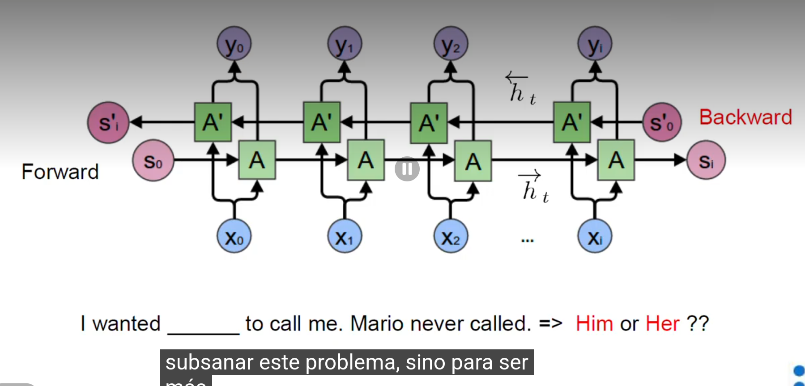
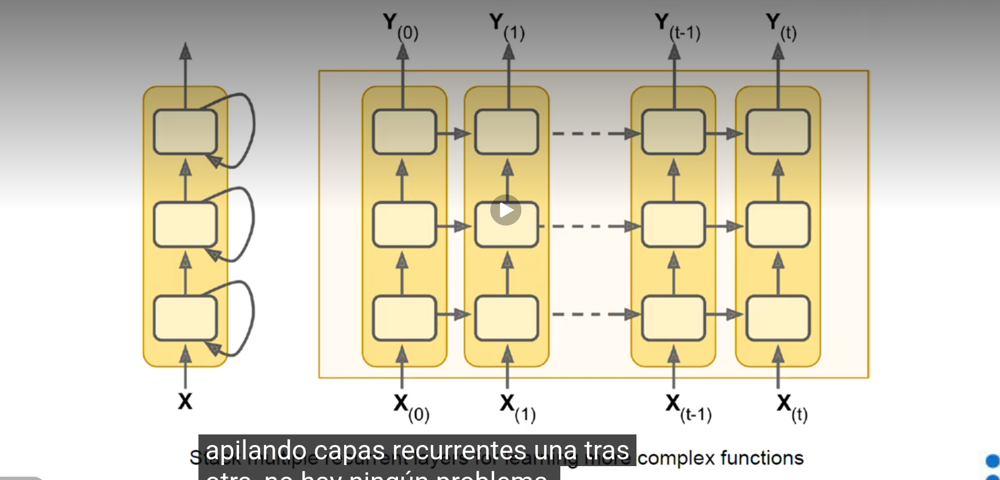

# RNN 
Sirven para entender como por ejemplo el lenguaje natural. CUando entra la voz en un micro, este la redibe la decoficia para que se peuda guardar en un ordenador (speech to text) y guardarse en archvios excel, csv,..

En estos casos es muy importante que estén todos los datos ordenados. Y la red neuronal tendra que ir observando de una en una palabra dentro de la iteracion. lo que va  haicnedo es actualizar su memoria su aprendizaje de la secuencia para que cuando termine la frase o parte vaya entiendendo la frase al completo. EN cada estado va a aprender lo que tiene teneniendo en cuenta lo observado anteriormente

## sequential processing

- Speech recognition
- sentiment analysis
- time series forecasting
- machine translation
- music generation

## problematicas

- uno de los porblemas es que en los otros tipos de redes, tenemos la entrada puesta como fija de tamaño mientras que en estos tipos de redes la longitud es variable
- otro problema es que a la hora de aparecer la informacion mas relevante va a estar siempre en el mismo sitio
- a veces puede ser que las referencias entre varias cosas, pueden aparecer muy espaciadades entre si, con l que genera mas problematica

## language model
es unn modelo matematica que dado una cadena de palabras puede asignarle una probabilidad a la frase.

## predictin new word

dada la secuencia de palabras que estas escribiendo o te sugiere una que el modelo cree q es correcta porq es mas probable a que lo escribas bien en lugar de equivocarte, o predice texto apra ayudarnos a ir mas rapido.

## time series forecasting

se hace tambien exactamente igual

## tipos de rnn

### one to one

simple dense net. no es una recurrente

### one to many

- generacion de musica
- generacion de texto
- image captioning

### many to one
- sentiment analysis

### many to many

- machine translation
- video classification

### bidirectional rnn

Basicamente lo que se usa este mecanismo es para poder tener como la vision completa de la frase para poder ir volviendo entre nodos y poder asi mejorar la precision de estos modelos 

### deep rnn

