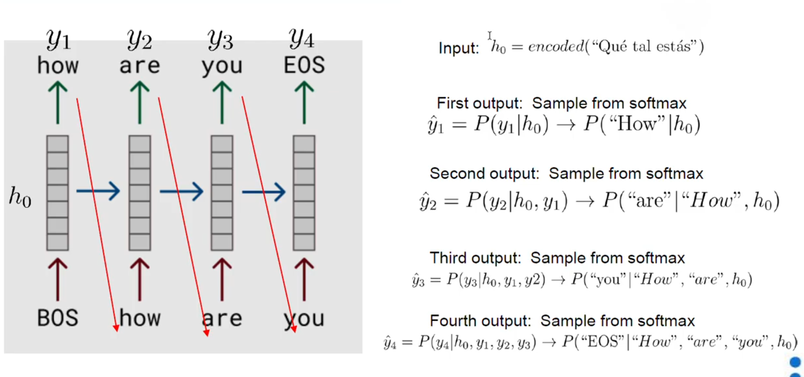

# seq2seq

este tipo de red es un tipo de modelos que se plantearon en un principiopara realizar traducciones a itmepo real. 
el objetivo es mapear secuencias de longitud variable en un vector unico

- 2 etapas (estan formados estos modelos asi): 
    - encoder: encoding the entire secuence into a fixedlenght vector called a context vector
    - decoder: reading from the context vector

- introduced by google en 2014
- maps vairable-lenghts sequences to a fixed lenght encoded vector

## choose output sequence

Es posible que tengamos mas de una opcion valida como output. por lo tanto ambas son correctas pero no las dos son las mismas. para ello:

search strategies:
- sampling from output softmax not allways return the best output sentence
- greedy (choose the max proobability from the softmax) doesn't work well
- need other search algorithms: beam search

basicamente podriamos probar otros tipos de algoritmos.

## attention mechanism

- the encoder processes the entire input sentence and encode it into a context vector. the decoder produces the words in a sentence one after another. long term dependencyproblems.
- performance of the encoder-decoder netword degrades rapidly as the length of the input sentence increases
- attention mechanism: sleectivily concentrating on a few relevant things, while ignoring others ( also provides some interpretability)

basiacmente funciona que para todos los valores que tenemos en el encoder ver cuales son los mas y los menos relevantes y agregarlos para el decoder